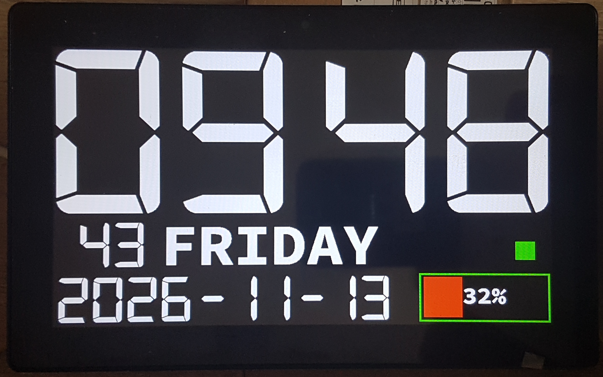
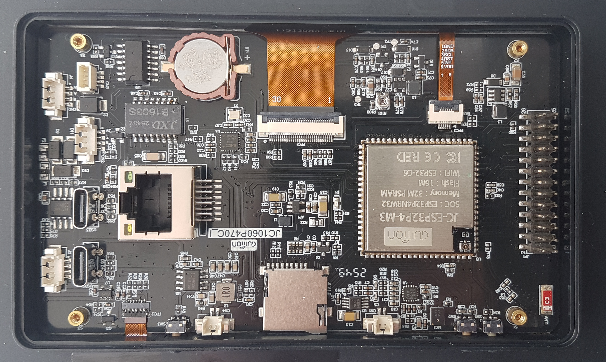

# ESP32-P4 MIPI-DSI – Guition JC1060P470C_I_W_Y (7.0" 1024×600)
 
# ---
 
 
---
🇬🇧 [English](#-english) | 🇵🇱 [Polski](#-polski)
---
## 🇬🇧 English

Bare-metal **ESP-IDF** starter project for the **Guition JC1060P470C_I_W_Y** development board featuring a 7.0" (1024×600) MIPI-DSI display and a GT911 capacitive touch controller.

> ⚠️ **WARNING – ESP32-P4 Silicon Revision (v1.3 / ECO2):**
> This board uses the **ESP32-P4 rev. v1.3 (ECO2)** chip. Be very careful when modifying `sdkconfig` / `sdkconfig.defaults` – do not overwrite the silicon revision settings, 32 MB PSRAM configuration, or compiler optimisation flags (`-Og`).

### 📊 Project Status (Milestones)

- [x] **Milestone 1:** MIPI-DSI bus wake-up, LDO3 power, PWM backlight, and **JD9165** driver initialisation (clean ~60 Hz output with zero DMA errors).
- [ ] **Milestone 2:** **GT911** touch controller integration on the shared I2C bus.
- [ ] **Milestone 3:** Hardware RTC setup and UI rendering (`stb_truetype`) in native 1024×600 landscape mode.

### ⚙️ Key Hardware & MIPI-DSI Parameters

| Parameter | Value | Notes |
| :--- | :--- | :--- |
| **Microcontroller** | ESP32-P4 (rev. v1.3 / ECO2) | 32 MB PSRAM, 16 MB Flash |
| **Co-processor** | ESP32-C6 | Wi-Fi 6 (2.4 GHz) / BLE over SDIO |
| **LCD Driver** | JD9165 (MIPI-DSI, 2 lanes) | 750 Mbps per lane (`lane_bit_rate_mbps = 750`) |
| **Resolution** | 1024 × 600 (Landscape) | Native landscape orientation (no PPA rotation needed) |
| **Refresh Rate / Pixel Clock** | ~60 Hz (59.11 Hz) / **52 MHz** | `H_total = 1364`, `V_total = 645` |
| **MIPI D-PHY Power** | Internal LDO Channel 3 | `2500 mV` |

### 📌 Verified Pinout (`pins_config.h`)

* **`LCD_RST`:** `GPIO_NUM_0` *(Strapping pin – do not hold low during boot; may require pressing the on-board RESET button after flashing).*
* **`LCD_LED` (PWM Backlight):** `GPIO_NUM_23`
* **`I2C_SDA` / `I2C_SCL`:** `GPIO_NUM_7` / `GPIO_NUM_8` *(Shared I2C bus for the GT911 touch controller and hardware RTC).*
* **`TOUCH_INT` / `TOUCH_RST`:** `GPIO_NUM_21` / `GPIO_NUM_22`
---
## 🇵🇱 Polski

Projekt bazowy w czystym **ESP-IDF** dla płytki rozwojowej **Guition JC1060P470C_I_W_Y** z wyświetlaczem 7.0" (1024×600) oraz panelem dotykowym GT911.

> ⚠️ **UWAGA – Rewizja krzemu ESP32-P4 (v1.3 / ECO2):**
> Płytka wyposażona jest w układ **ESP32-P4 w rewizji v1.3 (ECO2)**. Należy zachować szczególną ostrożność przy modyfikacji pliku `sdkconfig` / `sdkconfig.defaults` – nie nadpisywać ustawień rewizji układu, konfiguracji 32 MB PSRAM oraz flag optymalizacji kompilatora (`-Og`).

### 📊 Status projektu (Kamienie milowe)

- [x] **Milestone 1:** Wybudzenie magistrali MIPI-DSI, zasilania LDO3, podświetlenia PWM oraz sterownika **JD9165** (czysty obraz ~60 Hz bez błędów DMA).
- [ ] **Milestone 2:** Integracja panelu dotykowego **GT911** na współdzielonej szynie I2C.
- [ ] **Milestone 3:** Uruchomienie sprzętowego zegara RTC i renderowanie UI (`stb_truetype`) w natywnym układzie poziomym 1024×600.

### ⚙️ Kluczowe parametry sprzętowe i MIPI-DSI

| Parametr | Wartość | Uwagi |
| :--- | :--- | :--- |
| **Mikrokontroler** | ESP32-P4 (rev. v1.3 / ECO2) | 32 MB PSRAM, 16 MB Flash |
| **Koprocesor** | ESP32-C6 | Wi-Fi 6 (2.4 GHz) / BLE po SDIO |
| **Sterownik LCD** | JD9165 (MIPI-DSI, 2 linie) | 750 Mbps na linię (`lane_bit_rate_mbps = 750`) |
| **Rozdzielczość** | 1024 × 600 (Landscape) | Natywna orientacja pozioma (bez obrotu PPA) |
| **Odświeżanie / Pixel Clock** | ~60 Hz (59.11 Hz) / **52 MHz** | `H_total = 1364`, `V_total = 645` |
| **Zasilanie MIPI D-PHY** | Wewnętrzne LDO Kanał 3 | `2500 mV` |

### 📌 Zweryfikowany Pinout (`pins_config.h`)

* **`LCD_RST`:** `GPIO_NUM_0` *(Pin strappingowy – nie wymuszać stanu niskiego podczas bootowania; po flashowaniu może wymagać naciśnięcia przycisku RESET na płytce).*
* **`LCD_LED` (Podświetlenie PWM):** `GPIO_NUM_23`
* **`I2C_SDA` / `I2C_SCL`:** `GPIO_NUM_7` / `GPIO_NUM_8` *(Współdzielona magistrala dla dotyku GT911 oraz układu RTC).*
* **`TOUCH_INT` / `TOUCH_RST`:** `GPIO_NUM_21` / `GPIO_NUM_22`

---

